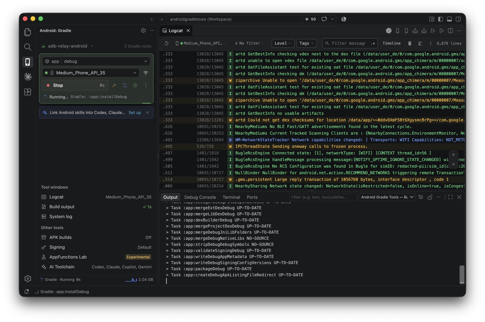

# Android Gradle Tools for VS Code

**Build, run, and debug Android apps in VS Code — no Android Studio required.** Open an existing Android Gradle project, choose a module, variant, and device, then press **Run**. The extension builds with your project's Gradle Wrapper, installs through ADB, and launches the app. Filter Logcat, jump from stack traces to source, and attach the built-in JDWP debugger to a debuggable Kotlin or Java app.

Works with both `build.gradle` and `build.gradle.kts`. This extension does not provide Kotlin editing; install a Kotlin language extension for highlighting and completion. Android Gradle Tools is an independent, open-source project under the [MIT license](LICENSE).

[**Install from the Visual Studio Marketplace**](https://marketplace.visualstudio.com/items?itemName=AndroidGradleTools.android-ide-extension) · [Source code](https://github.com/AndroidGradleTools/android-ide-extension) · [Changelog](CHANGELOG.md)

*An `app` debug run in progress, with the selected emulator, Logcat, and Gradle output visible.*

## Get running in three steps

**Before the first sync:** The extension uses a separate Gradle home by default. The first build may download dependencies again, and Gradle will not read settings in your usual `~/.gradle`, including proxy settings, private repository credentials, and init scripts. If your build needs them, turn off `android-ide-extension.gradleIsolateUserHome` in VS Code Settings before opening the Android panel. [Details](#why-does-my-build-behave-differently-from-android-studio-or-the-terminal)

1. **Open your project.** Open an existing Android Gradle project that includes `gradlew` or `gradlew.bat`. Have the Android SDK and a JDK supported by your project's Android Gradle Plugin installed.
2. **Open the Android panel.** Select the Android icon in the activity bar. The first sync discovers Gradle modules and build variants by default. Choose the Gradle root, module, variant, and a connected device or Android Virtual Device (AVD).
3. **Run.** Click **Run** to build, install, and launch the selected app. Use **Build output** for Gradle results and **Logcat** for device logs.

If setup fails, run **Android: Run Diagnostics** from the Command Palette to check the Gradle project, JDK, SDK, ADB, device, and variant. Set the SDK path or Gradle JDK from the Android panel settings when automatic detection misses them.

## Build and run Android apps in VS Code

- Build, sync, run, stop, and clean from the Android panel. Select Gradle-discovered variants, including product flavors, and the right root in a multi-root workspace.
- Run on a connected device or emulator. If the selected AVD is stopped, the extension can boot it while Gradle builds the app.
- See the build result, duration, APK path, and extracted failure reasons; open the full Gradle output for details. Use **Android: Stop Gradle Task** to cancel a running task.
- Browse cached APK builds, reinstall an earlier APK, or reveal its file for manual comparison or sharing.
- Set up release signing with a keystore picker or generator. Review a proposed Gradle file change before applying it. When you choose VS Code SecretStorage for passwords, the extension passes them to its Gradle process; terminal and CI builds need their own credentials.

## Logcat and ADB in VS Code

- Open **Android: Logcat** even without a Gradle project. Filter by package, level, tag, text, regular expression, crashes, or stack traces; save filters and export the filtered logs.
- Exclude noisy tags with a `-` prefix, such as `-OkHttp`, and jump from a stack-trace frame such as `MainActivity.kt:42` to its source line.
- Pair a device with wireless ADB or connect through a configured remote ADB relay when USB is inconvenient.

## Debug Kotlin and Java apps

Build and deploy a debuggable app, then run **Android: Attach Debugger to Process**. The included JDWP debugger supports Kotlin and Java source breakpoints, stepping, and variables without a separate debugger extension. It attaches to a running process; it does not launch under the debugger or debug native C/C++ code.

## Compose Preview on a device

Click **Preview on device** above a `@Preview` function, or run **Android: Run Compose Preview on Device**. The extension installs the debug variant of the app module on the selected device, opens the preview with `PreviewActivity`, and shows a screenshot beside the editor. The app module needs `debugImplementation("androidx.compose.ui:ui-tooling")`; **Android: Run Diagnostics** checks for it.

Previews in library modules and test source sets, and multipreview annotations declared in another file, are not supported yet. `@Preview` arguments such as `device`, `uiMode`, and `locale` are not applied; the preview uses the device's settings.

## Optional AI tools

The AI Toolchain page checks for the [Google Android CLI](https://developer.android.com/tools/agents/android-cli) and, when you choose to set them up, links bundled Android troubleshooting skills into detected folders for Codex, Claude, Copilot, Gemini, or Cursor. You can also collect focused build errors, diagnostics, and Logcat in a local Agent Context Bundle for review or sharing. None of these tools is required to build, run, or debug an app.

**Agent MCP server (off by default).** Run **Android: Connect AI Agent (MCP)…** to start a local server on `127.0.0.1` and copy ready-to-paste configuration for Claude Code, Codex, or Cursor; VS Code discovers it automatically when its MCP API is available. Coding agents then work on the same Gradle root, module, variant, and device you selected in the panel:

- `android_state` reports that selection and the last build result.
- `android_check` compiles only the modules with changed files and returns errors as `file:line:column` entries instead of the full Gradle log.
- `android_run` builds, installs, and launches on the selected device, and `android_preview` renders a Compose preview there. Both need `android-ide-extension.agentMcpAllowDeviceActions`.
- `android_logcat` returns the app's logs since its last launch, crashes first.

Agent builds wait in the same queue as panel builds, so they never collide on Gradle locks, and they add to **Build output** without replacing your last build's errors. Requests need a bearer token kept in VS Code SecretStorage; rotate it with **Android: Rotate Agent MCP Token**. These settings can only be changed in user settings, not by a workspace.

**Integrated terminals use the extension's JDK.** In an Android workspace, new terminals get the `JAVA_HOME` (and `PATH` entry) that extension builds use, so `./gradlew` in a terminal matches panel builds. Set `android-ide-extension.terminalGradleEnv` to `javaHomeAndUserHome` to share the extension's Gradle home too, or `off` to leave terminals alone.

## Requirements and scope

- **VS Code 1.85+** and an existing Android Gradle project with its Gradle Wrapper.
- **Android SDK with ADB** and a JDK compatible with the project's Android Gradle Plugin.
- **A deployment target:** a connected Android device or an AVD with the Android Emulator SDK package.

The extension runs on the local or Remote-SSH workspace host, where Gradle, the SDK, and ADB need to be available. With Remote-SSH, ADB runs on the remote host, so a USB device attached only to your laptop is not visible there; use wireless ADB or a configured relay to connect the device remotely. Device selection, Logcat, wireless ADB, system logs, and settings also work when no Gradle project is open.

Open the Command Palette and type **Android:** for extension commands. Most setup happens from the Android panel gear: set the SDK path, Gradle JDK, build settings, and optional Android Studio `keymap`.

## Common questions

### Can I build a Kotlin Android app in VS Code?

Yes. Open an existing Android Gradle project, including one using `build.gradle.kts`. The extension runs its Gradle Wrapper, installs the app through ADB, shows Logcat, and can attach to a debuggable process. Install a separate Kotlin language extension for editing features.

### Do I need Android Studio?

No. For this build, install, run, Logcat, and debug workflow, you need a JDK supported by your project's Android Gradle Plugin and the Android SDK. You can install the SDK with [Android SDK command-line tools](https://developer.android.com/tools). Android Studio remains useful for interactive Compose Preview, visual design, and profilers; this extension can render a single preview on a device.

### Does the Android emulator run inside VS Code?

No. The extension starts and targets a standard Android Virtual Device through the Android SDK. If the selected emulator is stopped, it can boot while Gradle builds your app.

### Why does my build behave differently from Android Studio or the terminal?

By default, a separate `GRADLE_USER_HOME` keeps the extension's daemons and caches apart. The first build may download Gradle and dependencies again. Gradle also will not read your usual `~/.gradle/gradle.properties` or `~/.gradle/init.d` from that separate home. Turn off `android-ide-extension.gradleIsolateUserHome` to use your normal Gradle home, or set `android-ide-extension.gradleUserHome` to a specific directory. If the first sync failed, change the setting and select **Retry**.

Integrated terminals get only the extension's JDK by default, so `./gradlew` in a terminal still reads your usual `~/.gradle`. If you set `android-ide-extension.terminalGradleEnv` to `javaHomeAndUserHome`, terminal builds use the extension's Gradle home instead and share its daemons; idle auto-stop skips daemons that are still building.

## Privacy and support

Agent Context Bundles stay in the extension's local global storage; the extension does not upload them. The agent MCP server listens only on `127.0.0.1`, rejects requests without its token or from web pages, and sends nothing off the machine; what an agent does with tool results is up to that agent. A bundle can contain app text, screenshots, paths, package IDs, device serials, or stack traces, so review it before sharing. If an error offers **Report**, choosing it opens `https://androidgradletools.org` with a sanitized error payload in the URL. The site receives that URL when opened; a crash report is submitted only after you press **Submit**. Disable this flow with `android-ide-extension.crashReportEnabled` if preferred.

For reproducible problems, [open a GitHub issue](https://github.com/AndroidGradleTools/android-ide-extension/issues). If it helps your workflow, you can leave an honest [Marketplace review](https://marketplace.visualstudio.com/items?itemName=AndroidGradleTools.android-ide-extension).

## Release notes

### 1.3.0 — 2026-09-30

- Added **Preview on device** above Compose `@Preview` functions: the extension installs the app module's debug build, opens the preview through `PreviewActivity`, and shows a screenshot beside the editor.
- Added an opt-in local MCP server so Claude Code, Codex, Cursor, and Copilot can check compile errors, run the app, render previews, and read Logcat on the module, variant, and device you selected. The panel's status strip shows connected agents and running tool calls.
- Panel builds, syncs, previews, and agent runs now share one Gradle queue, and integrated terminals get the extension's JDK.
- Added a What's New tab with illustrated how-to steps, opened from a one-time panel tip after an update or with **Android: What's New**.

### 1.2.0 — 2026-09-28

- Reworked the Android panel around a Studio-style run widget, bottom tool windows, a Gradle status strip, and focused notices.
- Sync now refreshes modules and variants, including flavored builds, and runs once when a project first opens by default. A failed sync offers **Retry**.
- Moved Settings, Release signing, wireless pairing, AppFunctions Lab, and AI Toolchain into full-panel pages. Settings support search and per-setting Reset.
- Added Stop for a running Gradle job, an optional Android Studio keymap, and a project-level way to dismiss signing checks when Gradle already handles release signing.

[Full changelog](CHANGELOG.md)
